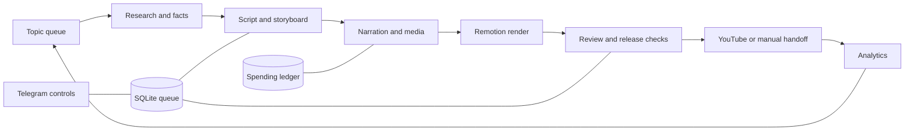

# Origins of Giants

A documentary-video production system built around Python, SQLite and Remotion. It connects topic research, scripts, narration, media selection, animated scenes, review, YouTube publishing and post-publication analytics.

**Channel:** [Origins of Giants / @Backsolve](https://www.youtube.com/@Backsolve)

This repository contains the source code and a small rendering sample. Full episodes, account credentials, production databases and private channel analytics are kept outside Git.

## The project

Producing a documentary involves more than generating a script. Sources, claims, narration, images, scene timing, publishing metadata and review decisions must stay consistent across a long workflow. This project models that workflow as a persistent queue, with artifacts for each episode and separate modules for each production stage.

The core format is a documentary about the history and business of recognizable brands. The code also contains Spanish-language production, an illustrated everyday-history format, and science explainers with calculated diagrams.

## What is implemented

- **Research and scripts:** source collection, structured facts, chapter planning, script generation and fact-checking through configurable language-model providers.
- **Media and narration:** speech synthesis with word timings, archive/stock media selection, generated illustrations, chapter pauses and sound mixing.
- **Rendering:** React/TypeScript compositions for documentary scenes, maps, people, charts, captions, thumbnails, branding and vertical videos.
- **Workflow reliability:** SQLite state transitions, process locks, resumable artifacts, review gates tied to content versions and upload receipts that help prevent duplicate uploads after interruption.
- **Operations:** Telegram controls with chat/user checks, per-video cost attribution, a shared spending ledger, publishing schedules and analytics snapshots.
- **Regression coverage:** tests for queue concurrency, review gates, upload recovery, media checks, spending receipts, localization and other failure paths.

These are code capabilities, not claims that every provider integration or production configuration is currently validated. Production runs require service credentials, suitable model choices, licensed media and operator review.

## Architecture



See [the architecture notes](docs/architecture.md) for the main modules and data contracts.

## Explore the rendering sample

The sample is an 18-second text-only storyboard with no production footage, narration or paid API calls. It demonstrates the existing `Main` composition and scene transitions; it is not a finished episode.

```bash
cd remotion
npm ci
npm run studio
# Or render the sample:
npm run render:sample
```

The sample files are in [`data/videos/sample`](data/videos/sample). Remotion may download its rendering browser on first use, and the main theme loads web fonts.

## Local setup

The source was developed with Python 3.12. The rendering layer uses React 18, TypeScript 5 and Remotion 4; exact JavaScript dependency resolutions are in `remotion/package-lock.json`.

```bash
python -m venv .venv
# Activate the virtual environment for your shell.
python -m pip install -r requirements.txt
```

Copy `.env.example` to `.env` and configure the services you intend to use. The template keeps automatic production and automatic approval disabled, uses manual upload mode, and enables strict review checks. Keep a separate data directory for experiments.

```bash
python -m orchestrator.main init
python -m orchestrator.main status
```

`doctor` checks dependencies, credentials and service connectivity; it is not an offline check. Production commands such as `topics`, `run`, `stage` and `watch` can call paid services or modify channel state according to configuration. See [operations](docs/operations.md) before running them.

## Repository map

| Path | Purpose |
|---|---|
| `orchestrator/main.py` | CLI, queue processing and scheduling |
| `orchestrator/db.py`, `locking.py` | Persistent state and process coordination |
| `orchestrator/stages/` | Research, scripts, assets, rendering, review, uploads and analytics |
| `orchestrator/spend.py`, `ancestors_budget.py` | Cost attribution, receipts and budget checks |
| `orchestrator/telegram.py` | Operator commands and authorization checks |
| `remotion/src/` | Scene components and video compositions |
| `prompts/` | Structured production prompts |
| `tests/` | Python regression suite |
| `data/videos/sample/` | Synthetic rendering sample |

## Verification

```bash
python -B -m unittest discover -s tests -v
cd remotion
npx tsc --noEmit
```

Validated on 9 November 2026:

- **Python:** 173 regression tests passed, with zero failures, errors or skips. The run used isolated temporary data, mocked providers and disabled network access.
- **TypeScript:** `tsc --noEmit` passed using the existing local dependencies, with no diagnostics.

Live provider integrations and a complete video render were not run during this validation. The tests exercise mocked rendering and publishing paths.

## Scope and current limitations

- Running the full production workflow requires configuring service accounts, media assets and channel-specific settings.
- Optional channel profiles retain some production-specific path and channel defaults. Configure those profiles before using them with another account or machine.
- Provider models, quotas and APIs can change. Review the model settings in `orchestrator/config.py` and current provider documentation before a production run.
- Some storyboard types still fall back to a simpler media scene; the available renderers are visible in `remotion/src/scenes/SceneRouter.tsx`.
- Real footage, music, voice assets and episode research are not distributed here. Their rights and factual suitability must be checked for each production.

Bundled geographical data is credited in [THIRD_PARTY.md](THIRD_PARTY.md).
